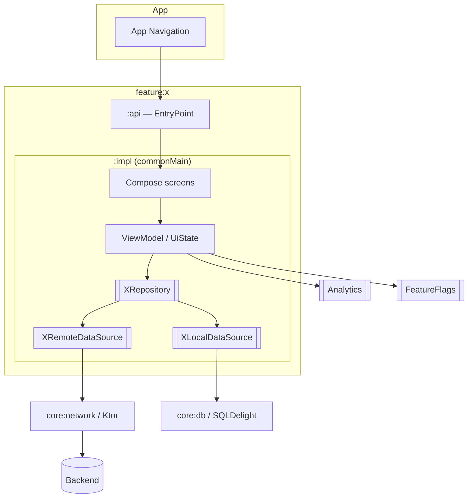

# Архитектура фичи на KMP + CMP

## Базовый шаблон (бери его, отклоняйся только с обоснованием)

```
:feature:<name>:api        — публичный контракт фичи: точка входа (Route/EntryPoint), модели для внешнего мира
:feature:<name>:impl       — всё остальное (commonMain + androidMain/iosMain по необходимости)
:core:*                    — уже существующее: network, db, design-system, analytics, navigation, feature-flags
```
Другие фичи зависят только от `:api`. Это даёт изоляцию, параллельную работу и быструю сборку.

Слои внутри `:impl` (всё в `commonMain`, пока нет платформенной причины):

| Слой | Что внутри | Зависит от |
|---|---|---|
| UI (Compose MP) | Screen-композаблы, stateless компоненты, превью | только `UiState` + callbacks |
| Presentation | `ViewModel`/StateHolder, `UiState`, `UiEvent`, `UiEffect` (UDF/MVI-lite) | UseCase / Repository интерфейсы |
| Domain (опционально!) | UseCase'ы только если есть реальная бизнес-логика, комбинирующая источники | Repository интерфейсы |
| Data | `Repository` (impl), `RemoteDataSource` (Ktor), `LocalDataSource` (SQLDelight/Room KMP/DataStore), мапперы DTO→domain | core:network, core:db |
| Navigation | Граф фичи, аргументы, deeplinks; наружу — только entry point | core:navigation |
| DI | Модуль фичи (Koin / kotlin-inject / то, что уже в проекте) | все слои |

Правила:
- **UI не знает про Data.** Composable получает `state` и лямбды — тогда его легко тестировать скриншотами и превью.
- **Всё, что пересекает слой, — интерфейс.** `LoyaltyRepository`, `LoyaltyRemoteDataSource`, `Clock`, `ConnectivityMonitor`, `AnalyticsTracker`, `FeatureFlags`. В тестах — fake-реализации (fake предпочтительнее mock-библиотек в KMP: MockK не работает на iOS/Native; Mokkery — вариант).
- **Domain-слой не плодить ради галочки.** Если UseCase = проксирование репозитория — убрать. Сказать это вслух интервьюеру — плюс.
- Ошибки: `Result`/sealed `DataError` из data-слоя, маппинг в понятные UI-состояния в presentation.
- Состояния экрана: Loading / Content / Empty / Error(retry) / Offline(показываем кэш + плашка).

## Данные и офлайн (частый провал — продумать явно)

Задай себе вопросы и ответь в 3–5 строк:
- **Источник правды:** сервер всегда прав; локальная БД — кэш для чтения (offline-first read) или вообще in-memory?
- **Стратегия:** stale-while-revalidate (показали кэш → запросили → обновили) — дефолт для большинства лент/профилей.
- **TTL/инвалидация:** когда кэш считается устаревшим; pull-to-refresh.
- **Пишущие операции офлайн:** нужны ли? Если да — очередь операций + идемпотентность + конфликт-резолв. Если можно не делать в MVP — не делаем и говорим это.
- **Пагинация:** cursor-based, Paging для KMP (`androidx.paging` common / своя простая реализация).
- **Чувствительные данные** (номера карт, токены): шифрованное хранилище (Keychain / EncryptedSharedPrefs через интерфейс `SecureStorage`), маскирование в логах.

## Платформо-зависимое

Чек-лист: камера/сканер штрихкодов, Bluetooth/NFC, геолокация, пуши, биометрия, платежи (Google/Apple Pay), Wallet-карты, виджеты, App Clips/Instant Apps, шаринг, разрешения, фоновые задачи, WebView-интероп.

Подход:
- Интерфейс в `commonMain` + реализации в `androidMain`/`iosMain` (через DI), а не `expect/actual` класс — так проще мокать. `expect/actual` — для мелких функций/фабрик.
- Если нужен нативный UI-компонент (камера, карта) — `AndroidView` / `UIKitView` внутри CMP-экрана.
- Каждый платформенный кусок = отдельная строка в оценке и в рисках (его нельзя протестировать один раз на обе платформы).

## Внешняя зависимость не готова (ключ, SDK, чужой API, лицензия)

Стандартный приём — не ждать:
1. **Интерфейс** на границе (`StoreMap`, `PaymentGateway`, `XRemoteDataSource`) — экран и ViewModel знают только его.
2. **Заглушка** за интерфейсом (fake-данные, Canvas-карта, MockEngine с фикстурами по контракту). На ней делаем UI, логику, тесты; она же — для screenshot-тестов.
3. **Ранний spike** с реальной зависимостью на демо-ключе/sandbox в первые дни — чтобы риск интеграции (особенно iOS interop) всплыл сразу, а не после получения боевого доступа. Заглушка маскирует риск — это надо сказать вслух.
4. Подмена реализации через DI, когда доступ получен; экран не меняется.
5. В оценке: интеграция реальной зависимости — отдельная строка + буфер; в рисках — владелец получения доступа и дата.

## Интеграция в существующее приложение

- Откуда вход: таб, пункт меню, deeplink, пуш. Какие флаги закрывают вход.
- Миграция с WebView/старой реализации: переключение через feature flag, возможность отката, параллельная жизнь двух реализаций.
- Если приложение «гибридное» (часть на нативе, часть на KMP) — как CMP-экран встраивается в нативную навигацию iOS (`ComposeUIViewController`) и Android.

## Mermaid-шаблон диаграммы


`[[...]]` — интерфейсы (мокаются в тестах).

## Самокритика — частые слабые места
- Переусложнение (Clean Architecture «на все слои» для 3 экранов).
- Не продумана офлайн-синхронизация / инвалидация кэша.
- Нет состояния ошибки/пустоты на макетах — дизайнеру работа.
- Не указано, кто владелец API и когда он готов.
- iOS-специфика (нативная навигация, жизненный цикл ViewModel, размер бинаря) забыта.
