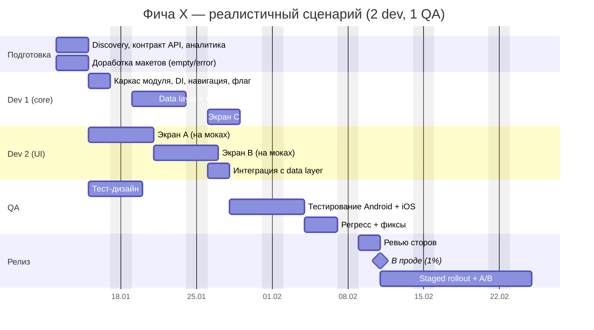

# Оценка, Гант, команда

Цифры ниже — стартовые эвристики. Всегда оговаривай: «оценка до доступа к коду/API, ±30%».

## Типовые этапы

1. **Discovery / подготовка** — изучение существующего кода и API, согласование контракта, аналитика событий, доработка макетов (empty/error/offline). 2–5 дн.
2. **Каркас** — модуль `:api/:impl`, DI, навигация, feature flag, заглушки экранов. 1–2 дн.
3. **Data layer** — DTO, Ktor-клиент, мапперы, репозиторий, кэш. 1–2 дн на эндпоинт; офлайн-кэш +2–4 дн; офлайн-запись с синхронизацией +5–10 дн.
4. **UI** — простой экран (список/карточки из ДС) 2–3 дн; средний (фильтры, табы, пагинация) 4–6 дн; сложный (анимации, кастомные компоненты, нативный interop) 6–10 дн. Новые компоненты дизайн-системы — отдельно.
5. **Платформенные интеграции** — каждая 2–5 дн на платформу.
6. **Тесты** — 25–35% от разработки (частично параллельно).
7. **QA** — тест-дизайн параллельно разработке; ручное тестирование 2 платформ 3–5 дн; регресс 1–2 дн; фиксы 20% от времени QA.
8. **Релиз** — ожидание релизного поезда, ревью стора 1–3 дн, staged rollout 1–2 недели, A/B 2–4 недели (параллельно, не блокирует «в проде»).

Буфер: +15–20% на неизвестное (больше, если нет доступа к коду/API).

## Ускорение с ИИ (честно)

| Тип работы | Ускорение |
|---|---|
| Бойлерплейт: DTO, мапперы, DI, модули | 40–60% |
| Верстка экранов по макету из ДС | 30–40% |
| Unit/screenshot-тесты | 40–50% |
| Бизнес-логика, кэш, синхронизация | 10–20% |
| Платформенные интеграции, дебаг iOS | 0–10% |
| Согласования, ожидание других команд, ревью стора | 0% |
| Ручное QA | 0–10% |

Итог по фиче обычно **20–35%**, не «в 2 раза». Контр-аргументы, которые надо назвать: ревью сгенерированного кода сеньором, риск «никто не знает, что внутри», критический путь часто упирается в внешние зависимости, а не в скорость написания кода.

## Команда: min / max

Логика:
- **Минимум** — 1 KMP-разработчик (fullstack по фиче, Android+iOS), QA 0.5, дизайнер по запросу (ДС уже есть). Самый длинный срок, bus factor = 1.
- **Максимум** — параллелизм ограничен числом независимых потоков работ: (a) каркас + data layer, (b) по одному разработчику на 1–2 независимых экрана, (c) iOS-специфика. Обычно **3 разработчика** (один из них ведущий — feature owner), QA 1, дизайнер 0.25–0.5. Больше — закон Брукса: координация и мерж-конфликты съедают выигрыш, а контракт/data-слой — общая точка.
- Отдельный Compose-UI разработчик не нужен, если в команде нормальные KMP-разработчики. Бэкенд — только если нужны новые/изменённые API.
- Найм: 1–3 мес + онбординг 2–4 нед. Если срок фичи < 3 мес — **нанимать под эту фичу бессмысленно**, только перераспределять внутри компании/брать подрядчика. Сказать это продакту.

Сценарии для Ганта:
- **Минимум и максимум — всегда.** Оптимум — только если до прода отличается от обоих хотя бы на ~неделю или это осознанный компромисс (например, 2 dev без найма). Иначе не рисуй и скажи почему.
- Один и тот же список работ во всех сценариях; меняется только распределение. В максимуме добавь +10–20% к задачам, которые делят несколько человек (координация, интеграция).
- Одна секция = один человек; у человека задачи идут последовательно.
- Честный вывод под диаграммой: если максимум даёт выигрыш в пару дней — так и сказать: лишний человек упирается в критический путь, деньги лучше потратить на снятие внешнего риска.

Формат ответа:

| Вариант | Состав | Срок без ИИ | Срок с ИИ | Минусы |
|---|---|---|---|---|
| Min | 1 dev, 0.5 QA, дизайнер по запросу | … | … | bus factor, долго |
| Opt | 2 dev, 1 QA, 0.25 дизайнер | … | … | … |
| Max | 3 dev, 1 QA, 0.5 дизайнер | … | … | координация |

## Скоуп-варианты

| Вариант | Что входит | Что режем / откладываем | Срок |
|---|---|---|---|
| «Жёсткий дедлайн» | 1–2 ключевых экрана, только чтение, онлайн | офлайн, вторичные экраны, A/B | … |
| MVP | основные экраны, кэш на чтение, флаг, аналитика | второстепенные экраны, анимации | … |
| Full | всё по макетам | — | … |

Если продакт не даёт резать: параллелизация (contract-first, моки API), релиз под флагом частями (dark launch), снижение покрытия ручного QA ценой риска — назвать цену явно.

## Mermaid Gantt — шаблон

Отметь **критический путь** словами (обычно: контракт API → data layer → интеграция → QA).
